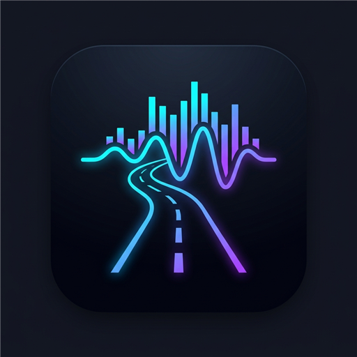
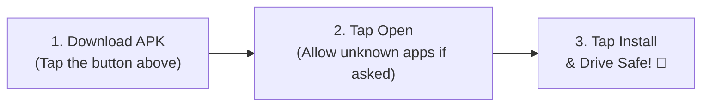

# ⚡ AutoWave Radio
### **Pure Driving Radio. Zero Distractions.**
**Live Hit Radio & Curated Driving Moods for Android & Android Auto**

 

  

[📱 **Direct APK Download**](autowave-radio-v5.8.0-release.apk) • [🌐 **Live Web Player**](web/) • [🛡️ **Privacy Policy**](privacy.html)

---

## 🚘 Why AutoWave Radio?

Most radio apps on phones and in cars are cluttered with banner ads, noisy trackers, bloated code, and complex menus that are dangerous to navigate while driving.

**AutoWave Radio** was engineered from scratch specifically for the road:
* 🚗 **Native Android Auto Integration:** Plugs seamlessly into your vehicle dashboard display.
* 🎛️ **Full Steering Wheel Controls:** Skip forwards and backwards between curated stations without interrupting or restarting playback.
* 🗣️ **Gemini & Google Assistant Voice Commands:** *"Hey Google, play Z100 on AutoWave Radio"*.
* 🛡️ **Zero Tracking, Zero Accounts:** No subscriptions, no login screens, no analytics beacons, and no added ads.
* 📻 **Curated Live Radio Streams:** Hand-picked, live-probed, ultra-fast streaming servers across Pop, Latin, Rock, and Chill.

---

## 🎧 Curated Driving Mood Shelves

AutoWave Radio categorizes live broadcasts into mood-tailored driving shelves:

| Mood Shelf | Icon | Description & Vibe | Top Broadcasts |
| :--- | :---: | :--- | :--- |
| **Pop Hits** | ⭐ | The world's biggest Top 40 chart-toppers and fresh global hits | KIIS FM, Z100 NY, Capital FM, Hits Radio |
| **Latin & Spanish** | 💃 | Reggaeton, Latin pop & Spanish rhythms from Madrid to Miami | LOS40, Cadena Dial, Mega 97.9 NY |
| **Long Drive** | 🛣️ | Highway cruising rhythms, road trip anthems & melodic pop beats | Capital FM, 103.5 KISS FM, Heart UK |
| **Fun & Energy** | ⚡ | High-tempo EDM, party dance hits & upbeat energy to keep you alert | Kiss FM, Capital Dance, KISSTORY |
| **Calm & Chill** | ☕ | Acoustic, ambient, soft pop hits & relaxing night drives | Smooth Radio, Chill UK, Magic Radio |
| **Rock Anthems** | 🎸 | Classic rock, modern alternative, and driving guitar tracks | Absolute Rock, Radio X, Planet Rock |
| **News & Commute** | 📰 | Live 24/7 world news, talk, and daily commute updates in clear English | NPR 24h, LBC News, Bloomberg Radio |

---

## 📱 How to Install on Android in 3 Simple Steps

1. **Download:** Tap the [Download APK Link](autowave-radio-v5.8.0-release.apk) (only 3.8 MB).
2. **Open:** When download completes, tap the notification or open the file from your Downloads folder.
   *(If prompted by Android: toggle "Allow from this source" to permit installation).*
3. **Launch:** Tap **Install** and open **AutoWave Radio**!
4. **In the Car:** Connect your phone to your car using USB or Wireless Android Auto — AutoWave Radio appears automatically on your car display.

---

## 🛠️ Technical Specifications

* **App Name:** AutoWave Radio
* **Package ID:** `com.autowave.radio`
* **Version:** `5.8.0` (Build 23)
* **File Size:** ~3.8 MB (R8 / ProGuard optimized)
* **Min Android Version:** Android 6.0 (API 23+)
* **Target Android Version:** Android 15 / 16 (API 36)
* **Audio Engine:** AndroidX Media3 / ExoPlayer with circular queue management
* **Security & Signing:** Signed with production Keystore (V1, V2, V3 APK signature scheme)

---

  AutoWave Radio is an independent radio streamer aggregating publicly available broadcasts. All radio trademarks and logos belong to their respective broadcaster networks. 
  Drive Safe. Keep your eyes on the road.

