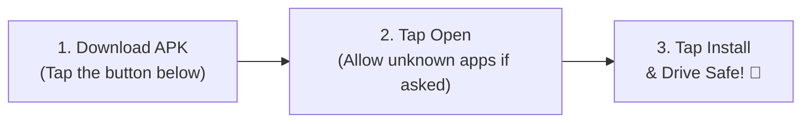

# 🌊 DriveWave
### **Pure Driving Radio. Zero Distractions.**
**Live English Hit Radio & Curated Driving Moods for Android & Android Auto**

 

  

[📱 **Direct APK Download**](https://github.com/bambadooma-star/drivewave-app/releases/download/v3.0.0/drivewave-v3.0.0-release.apk) • [🌐 **Live Web Page**](https://bambadooma-star.github.io/drivewave-app/) • [☕ **Support Developer**](https://www.paypal.com/ncp/payment/QUWBYM2LFLTYS)

---

## 🚘 Why DriveWave?

Most radio apps on phones and in cars are cluttered with banner ads, noisy trackers, bloated code, and complex menus that are dangerous to navigate while driving.

**DriveWave** was engineered from scratch specifically for the road:
* 🚗 **Native Android Auto Integration:** Plugs seamlessly into your vehicle dashboard display.
* 🎛️ **Full Steering Wheel Controls:** Skip forwards and backwards between curated stations without interrupting or restarting playback.
* 🗣️ **Gemini & Google Assistant Voice Commands:** *"Hey Google, play Z100 on DriveWave"* or *"Hey Google, play Rock on DriveWave"*.
* 🚫 **Zero Ads, Zero Accounts, Zero Tracking:** No subscriptions, no login screens, no analytics beacons, and no interruptions.
* 📻 **171 English-Only Live Verified Streams:** Hand-picked, live-probed, ultra-fast streaming servers across the US & UK.

---

## 🎧 6 Spotify-Inspired Driving Mood Shelves

Instead of boring geographic station directories, DriveWave categorizes live broadcasts into **6 mood-tailored driving shelves**:

| Mood Shelf | Icon | Description & Vibe | Top Broadcasts |
| :--- | :---: | :--- | :--- |
| **Long Drive** | 🛣️ | Highway cruising rhythms, road trip anthems & melodic pop beats | Capital FM, BBC Radio 1, Heart UK |
| **Fun & Energy** | ⚡ | High-tempo EDM, party dance hits & upbeat energy to keep you alert | Kiss FM, Z100 NY, Capital Dance |
| **Calm & Chill** | ☕ | Acoustic, ambient, soft pop hits & relaxing night drives | Smooth Radio, Chill UK, BBC Radio 2 |
| **News & Commute** | 📰 | Live 24/7 world news, talk, and daily commute updates in clear English | BBC World Service, BBC Radio 4, NPR 24h, LBC News |
| **Rock Anthems** | 🎸 | Classic rock, modern alternative, and driving guitar tracks | Absolute Rock, Radio X, Planet Rock |
| **Pop Hits** | ⭐ | The world's biggest Top 40 chart-toppers and fresh global hits | KIIS FM, BBC 1Xtra, Hits Radio |

---

## 📱 How to Install on Android in 3 Simple Steps

Installing DriveWave on any Android smartphone or tablet takes less than 30 seconds:

1. **Download:** Tap the [Download APK Link](https://github.com/bambadooma-star/drivewave-app/releases/download/v3.0.0/drivewave-v3.0.0-release.apk) (only 3.6 MB).
2. **Open:** When download completes, tap the notification or open the file from your Downloads folder.
   *(If prompted by Android: toggle "Allow from this source" to permit installation).*
3. **Launch:** Tap **Install** and open **DriveWave**!
4. **In the Car:** Connect your phone to your car using USB or Wireless Android Auto — DriveWave appears automatically on your car display.

---

## 🛠️ Technical Specifications

* **App Name:** DriveWave
* **Package ID:** `com.drivewave.autoradio`
* **Version:** `3.0.0` (Build 4)
* **File Size:** 3.64 MB (R8 / ProGuard optimized)
* **Min Android Version:** Android 6.0 (API 23+)
* **Target Android Version:** Android 15 / 16 (API 36)
* **Audio Engine:** AndroidX Media3 / ExoPlayer with circular queue management
* **Security & Signing:** Signed with production DriveWave Keystore (V1, V2, V3 APK signature scheme)

---

## ☕ Support the Developer

DriveWave is built with passion, free of charge, and without commercial ads. If you enjoy driving with DriveWave, you can support ongoing maintenance and radio stream hosting:

---

  DriveWave is an independent radio streamer aggregating publicly available broadcasts. All radio trademarks and logos belong to their respective broadcaster networks. 
  Drive Safe. Keep your eyes on the road.

